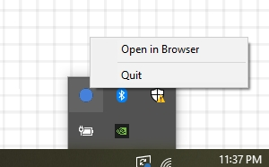
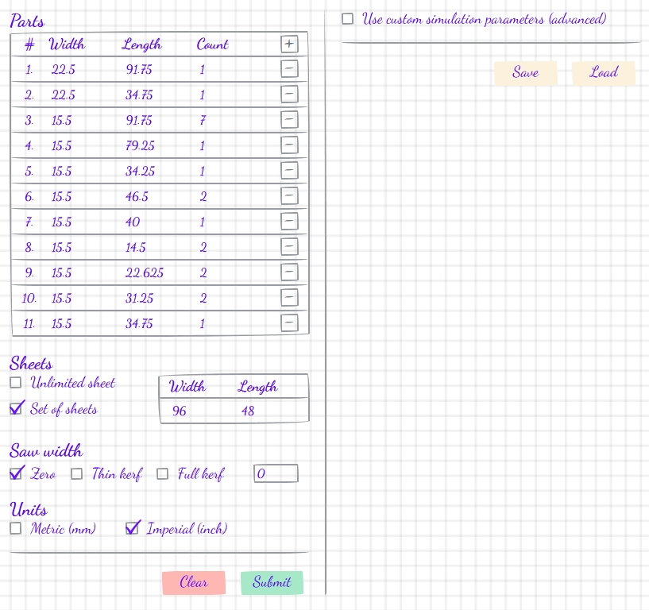
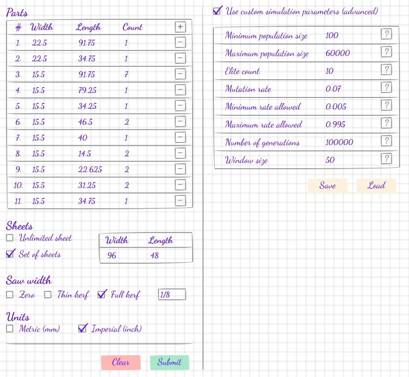
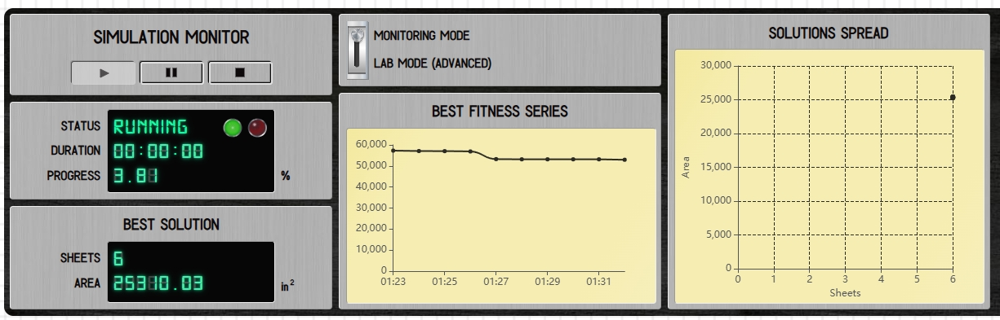
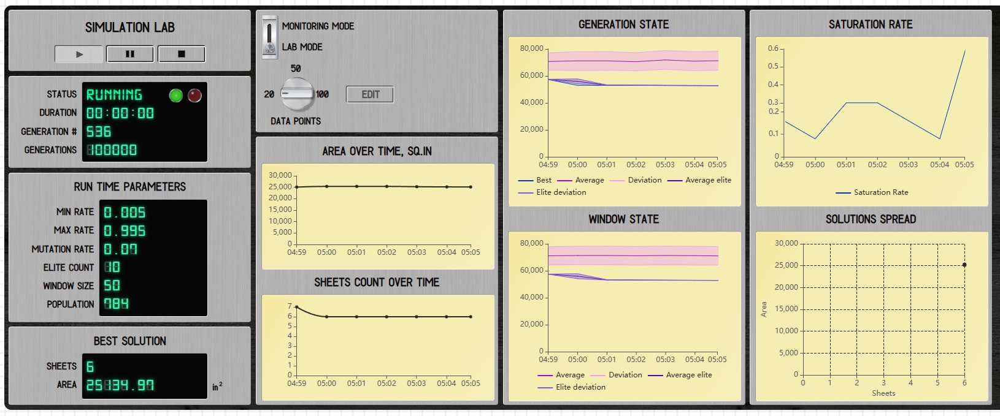
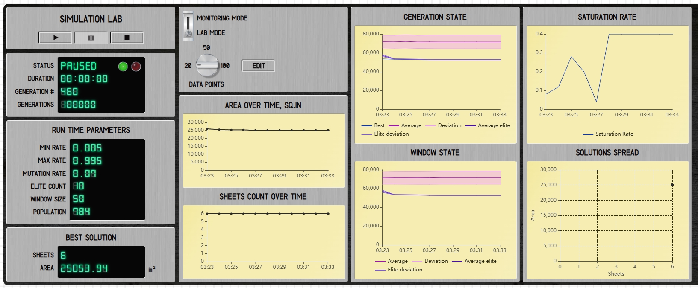
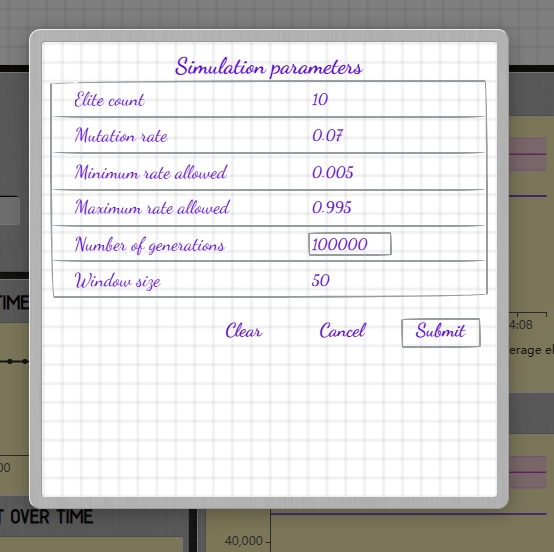
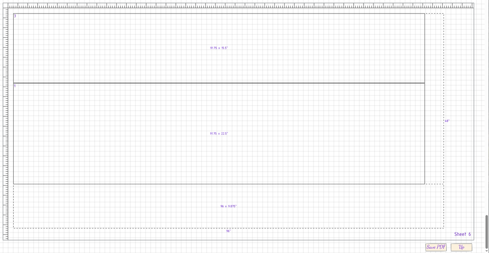
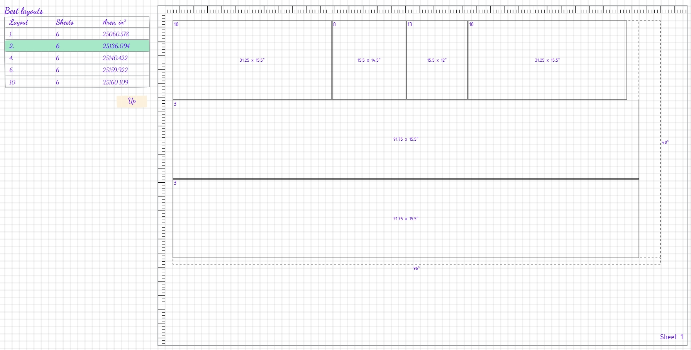

# CSP-2D-lab — Interactive cutting stock optimization tool

> An application for near-optimal solving the 2D Stock Cutting Problem, powered by a Genetic Algorithm engine with 
> real-time visualization, manipulation, and experimentation.


---

## Overview

2D Stock Cutting Problem (CSP-2D) is a cutting stock optimization problem commonly used in woodworking, metalworking, 
glass cutting, and other domains where material waste reduction matters.

As this problem is NP-hard, it is practical to find a near-optimal solution using approximate methods. As this problem 
is discrete, and its solution space is not allowed to get gradient, this problem is solved by the multi-epoch simulation 
known as Genetic Algorithms (GA).

This tool is my attempt to bundle my experiments with adaptive GA and my lab software to something useful. I used 
CSP-2D problem as close to my needs in a workshop while I cut plywood sheets.

It can be used 
1. Directly, to find the best sheet layouts
2. To experiment with GA adaptation using the bundled Lab UI and using CSP-2D as a sample problem.

---

## Features

- **Interactive input using web UI** — Allows either problem definition (sheet size, parts sizes/count, etc.) or GA parameters definition.
- **Save/Load input data** — Allows saving and loading problem definition using text files.
- **Unit support** — Works with both metric (mm) and imperial (in) units, including fractions.
- **Real-time visualization** — Live convergence charts and layout previews as the solver runs.
- **Early stopping** — Allows stopping the solver prematurely with printing intermediate results.
- **Pause / Resume / Adjust parameters** — Adjusting the solver mid-run using the Lab function.
- **PDF export** — Download a printable report of the best layout found
- **Client-server architecture** — Allows running the containerized server remotely, in a Cloud, and connecting via browser. 
  Server is multi-tenant, can run multiple simulations in isolation.
- **Portable package** — A single executable file includes the server that can run directly from the operating system (macOS, Windows).

---

## Requirements

Depend on where you run the application:

1. Containerized: Linux, make, Docker
2. Standalone: Windows 10+ or macOS 14+

---

## Quick Start

### Installation

**Containerized**

Docker image is nowhere, needs to be built from the sources.

   ```bash
   git clone {TODO: ADD URL like https://github.com/your-org/csp2d.git}
   cd csp2d
   make docker-build
   make docker-run
   ```

**Standalone**

1. Download your version
   1. Windows: {TODO: ADD LINK}
   2. macOS: {TODO: ADD LINK}
2. Run it from the downloaded file

Once you start the standalone executable file, it will try to open your browser automatically with the server URL. 
You need to give permission to do this operation if the operating system asks you. Or you can run the browser manually 
and connect to http://localhost:8080. The server part can be managed from the tray icon.



**Note:** If you run several standalone instances simultaneously each of them will run on a different port (the first 
unused port it found starting from 8080). So it is better if the application opens the browser with the port it already
knows.

---

### Using the Application

Once the browser opens the application, the input form looks like this:



- **Parts:** Parts to be cut out of the stock. You specify the width, length, and count of items. For numbers, you can 
  use either a decimal point format (like `1.25`) or fractions (like `1 1/4`).
- **Sheets:** The unconstrained problem means the sheet is unlimited. In this case the simulation finds the optimal 
  layout with minimal circumscribed rectangle. The constrained problem is 2-criteria optimization. It finds the layout 
  with a minimum number of sheets and minimum total area of circumscribed rectangles from every sheet. For a constrained
  problem (Set of sheets) you specify the dimension of sheets, assuming each of them has the same dimensions. You can
  use a decimal or fraction format of the numbers.
- **Saw width:** In real world the cutter has its own non-zero width. In the case of scissors, it actually can be zero.
  Saw blade can be full/thin kerf (standard) or something uneven/custom. You can select or enter the value directly.
- **Units:** Both metric and imperial units are supported. They do not affect calculations and are only used in the output.
- **Parameters:** These parameters do not belong to the problem itself. They are used to initially adjust the GA.



You can click on the **[?]** icon to get the explanation about every parameter.
- **[Save] button:** You can save the current problem definition and GA parameters to the file.
- **[Load] button:** Is used to fill the form from the previously created file. A file has a text format:

```
Sheets
96;48

Parts
22.5;91.75;1
22.5;34.75;1
15.5;91.75;7
15.5;79.25;1
```
Where sheets constraint is semicolon-separated `width;length`, parts is semicolon-separated `width;length;count`. 
Parameters are also supported.

- **[Clear] button:** Flushes the form.
- **[Submit] button:** Starts simulation. You can start and monitor several simulations simultaneously from different 
  browser tabs.

Once simulation starts, the monitor appears. The simplest monitor shows the progress of the simulation. You can switch 
to the Lab mode to see more and control the simulation in real time.



- **Control panel:** Allows pausing/resuming simulation. It allows stopping simulation prematurely to show intermediate 
  results. This can be used if simulation doesn't progress with many epochs. Although there are stopping mechanisms 
  bundled in the simulation preventing this situation, that work quite efficiently.
- **Indicator panel:** Displays status and progress in %. It shows how many epochs (generations) passed as % to the 
  configured maximum number. Simulation usually ends before it reaches 100%.
- **Best solution panel:** Displays fitness metrics of the best solution found so far. In the constrained problem it 
  displays how many sheets the layout requires, and what is the area of the layout including waste.
- **Lab control panel:** Not enabled in the Monitoring mode, but lets you switch to the Lab mode.
- **Metrics:** In the monitoring mode we display only two metrics.
    - **Best fitness series:** Displays the best fitness over time. Fitness in this metric is calculated as a single
      value combining both optimization criteria, as they both can be represented as area. \
      $n \cdot width_{sheet} \cdot length_{sheet} + \sum_{i=1}^{n} {area}_i$, where n is the number of sheets in the layout. \
      This value is not used in calculations, it only displays in this chart.
    - **Solutions spread:** Frontier of the elite subset (solutions) found so far.
      
In Lab mode we display many more metrics and allow tweaking the algorithm by adjusting parameters in real time.



The **Control panel** and **Best solution panel** are the same. The **Indicator panel** displays:
- **Generation #:** How many epochs (generation) passed so far.
- **Generations:** Upper boundary of the generations. Simulation stops when the upper boundary reaches. Usually it stops 
  much earlier.
- **Min/max rates:** The boundaries of the crossover and mutation rates. The adaptive GA adjusts these rates in 
  real-time based on the metrics at the every epoch. Boundaries prevent the algorithm from collapsing to 100% 
  exploration or 100% exploitation.
- **Mutation rate:** Mutation rate is a parameter that controls the frequency of mutation in the population. 
- **Elite count:** Number of the protected (elite) species in every generation. 
- **Window size:** As runtime metrics are highly volatile, we average them over a window of the last N generations. 
  Adaptive GA makes decisions based on the averaged values to do not overreact on random spikes.
- **Population:** Number of species in every generation. This is a calculated value based on the problem size. But you 
  can set up boundaries for this value in the parameters.

Metrics that we display in the lab:

- **Sheets and area over time:** Two fitness metrics, not combined to a single value, displayed separately here.
- **Single generation and window metrics:** Two metrics charts, instantaneous and averaged over the window. They show:
    - **Best solution fitness:** $f_{best}$ Combined fitness value, same as we display in the Monitoring mode chart.
    - **Average fitness over the population:** $\overline{f}$ Combined fitness value, averaged over a whole population.
    - **Standard deviation of $\overline{f}$:** Standard deviation of the fitness value in a whole population.
    - **Average fitness over the elite:** $\overline{f_{elite}}$ Combined fitness value, averaged over the elite.
    - **Standard deviation of $\overline{f_{elite}}$:** Standard deviation of the fitness value in the elite. The 
      algorithm stops when this value averages to zero over the window. This situation means that simulation converged 
      to a minimum and unable to leave that dip. Further processing does not make sense in this case. This minimum can 
      be either local or a global minimum.
- **Saturation rate:** GA considers saturated if a crossover operation is unable to produce unique species as offspring.
  In this case GA raises the exploration by introducing a new random migrant instead of the crossover's offspring. This
  chart shows the percent rate of migrants over the whole population. Usually it is less than 1%.
- **Solutions spread** is the same as in the Monitoring mode chart.

Lab control panel shows a toggle "how many points to display in the chart" (pure display function, it won't affect any 
computations). To control the simulation, there is a button **[Edit]** on this panel.

To control the simulation, you need to put it on pause first:



Then, the **[Edit]** button enables. Clicking that, the parameter dialog appears:



Same control parameters that are in the input form. You can adjust them and look how it changes the metrics and the 
overall convergence of the GA.

When simulation ends by itself, or you press **[Stop]** on the control panel, the results display. Usually it is the 
single best solution. We consider two solutions with the same fitness criteria values as the same solution. So we choose the 
first.

If the problem is constrained, we display each sheet and parts layout on these sheets. If unconstrained, there is a 
single layout.



If the result contains several solutions, you can select one of them in the table that appears on the left and layouts 
dynamically redraw on the right to display the corresponding solution.



- **[Save PDF]** button converts the layouts to a printable format.
- **[Up]** button scrolls the screen up to the problem definition form.